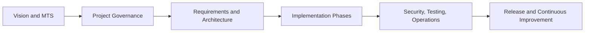

# PROJECT CHARTER

| Field | Value |
|---|---|
| Document ID | SUNDB-PC-001 |
| Document Title | PROJECT CHARTER |
| Version | 0.1.0 |
| Status | Draft |
| Created Date | 2026-11-02 |
| Last Updated | 2026-11-02 |
| Owner | SUNDB Project Office |
| Related Documents | MTS, PRD, Project Development Plan |

## 1. Document Purpose
Dokumen charter proyek SUNDB yang menata visi, ruang lingkup, stakeholder, tujuan, deliverables, dan kriteria keberhasilan.

## 2. Scope
Dokumen ini membatasi ruang lingkup, asumsi, tanggung jawab, dan output yang diharapkan untuk area Project Governance. Dokumen ini diturunkan dari MTS SUNDB dan berfungsi sebagai referensi teknis yang dapat ditinjau sebelum persetujuan formal.

## 3. References
- MASTER TECHNICAL SPECIFICATION (MTS).md
- AGENT.md
- Dokumen turunannya yang relevan dalam struktur docs/
- Standar pengembangan dan operasional internal SUNDB

## 4. Definitions and Terminology
- SUNDB: Sun Universal Database.
- SUNQL: SUNDB Query Language.
- SDBF: SUNDB Binary File Format.
- WAL: Write-Ahead Log.
- MVCC: Multi-Version Concurrency Control.
- ACID: Atomicity, Consistency, Isolation, Durability.
- TBD: To be determined, pending review and decision.

## 5. Background
SUNDB dirancang sebagai database universal modular yang bersifat independen, aman, scalable, dan dapat dikembangkan secara bertahap. Dokumen ini menerjemahkan keputusan arsitektur pada MTS menjadi pedoman yang lebih aplikatif untuk tim teknis, QA, operasional, dan manajemen proyek.

## 6. Detailed Specification
### 6.1 Visi dan Misi Proyek
SUNDB bertujuan menjadi database universal yang independen, modular, aman, dan skalabel. Visi utama proyek adalah menyediakan mesin database yang mampu menangani relasional, dokument, graph, vector, dan key-value dalam satu arsitektur terpadu, tanpa ketergantungan pada DBMS eksternal sebagai inti eksekusi.

Misi utama SUNDB adalah:
- Mengembangkan kernel database mandiri berbasis Rust.
- Menyediakan format penyimpanan biner internal SDBF.
- Mengembangkan bahasa query sendiri, SUNQL.
- Menjamin integritas data melalui WAL, MVCC, dan mekanisme recovery.
- Menyediakan keamanan end-to-end sejak tahap desain.
- Membuka jalur distributed computing, AI integration, dan API lintas platform.

### 6.2 Tujuan Proyek
- Membangun kernel database independen dan modular.
- Menyediakan storage engine dengan checkpoint, recovery, dan validasi integritas.
- Mendukung multi-model data dan query engine terpadu.
- Menghasilkan dokumentasi teknis yang siap ditinjau dan diimplementasikan.
- Mencapai kesiapan untuk fase beta dan release dengan jumlah risiko yang terkendali.

### 6.3 Ruang Lingkup Proyek
Ruang lingkup SUNDB mencakup:
- Database engine untuk workload OLTP dan analytics dasar.
- Penyimpanan data fisik SDBF dan jurnal WAL.
- Query engine SUNQL dengan parser, planner, dan optimizer.
- Transaction engine dengan ACID dan MVCC.
- Security engine dengan autentikasi, otorisasi, dan enkripsi.
- Distributed database architecture untuk replikasi, sharding, dan failover.
- AI subsystem untuk vector search, semantic query, dan integration data.

### 6.4 Stakeholder Utama
- Project owner dan sponsor produk.
- Architect dan engineering lead.
- Tim kernel, storage, query, security, dan distributed systems.
- QA, reliability, dan operations.
- Developer eksternal serta ecosystem integrator.
- Customer dan pengguna akhir yang membutuhkan basis data universal.

### 6.5 Deliverables
- Master technical specification dan dokumen turunan yang lengkap.
- Arsitektur modul dan desain internal.
- Standar pengembangan, keamanan, rantai release, dan operasional.
- Rencana QA, benchmark, serta prosedur backup dan recovery.
- Dokumentasi user, admin, dan developer yang siap digunakan.

### 6.6 Batasan dan Keterbatasan
- Implementasi awal difokuskan pada platform Linux dan arsitektur modular.
- Fitur distributed, AI, dan multi-model tertentu masih masuk kategori planned atau proposed sampai persetujuan formal.
- Benchmark performa tidak boleh diklaim tanpa data pengujian yang terverifikasi.

### 6.7 Risiko Utama
- Kompleksitas multi-model pada satu platform.
- Risiko integrasi keamanan dan otorisasi pada query dan AI layer.
- Kegagalan distributed consistency dan failover.
- Corruption data atau recovery gagal pada sistem produksi.
- Klaim performa yang tidak dapat direproduksi.

### 6.8 Kriteria Keberhasilan
- Arsitektur inti dapat diimplementasikan dengan struktur modular yang jelas.
- Data dapat disimpan, diakses, dan dipulihkan secara konsisten.
- Query SUNQL dapat dieksekusi dengan validasi sintaks dan keamanan.
- Sistem dapat menjalani transaksi dengan ACID dan recoverable state.
- Asset dokumentasi dan arsitektur siap digunakan untuk pengembangan tahap lanjutan.

## 7. Architecture or Process Flow

## 8. Interfaces and Dependencies
- Input utama: MTS, roadmap, product expectations, stakeholder constraints.
- Output utama: dokumen charter, rencana pengembangan, kebutuhan produk, dan keputusan teknis.
- Dependency: requirement engineering, architecture review, security review, release governance, dan change control.

## 9. Security Considerations
- Akses ke dokumen dan keputusan proyek harus mengikuti least privilege.
- Informasi sensitif seperti konfigurasi keamanan dan data operasional harus dibatasi aksesnya.
- Setiap perubahan besar pada arsitektur harus dianalisis dengan pendekatan risk-based review.

## 10. Error Handling
- Risiko yang teridentifikasi harus dibedakan antara technical, operational, dan compliance risk.
- Semua isu kritis harus masuk ke daftar open issues dan TBD untuk keputusan formal.
- Kegagalan pelaksanaan harus dilaporkan dengan dampak, root cause, dan rencana mitigasi.

## 11. Performance Considerations
- Perkiraan timeline, capacity, dan throughput perlu didasarkan pada benchmark awal dan asumsi yang jelas.
- Pengukuran performa harus mencakup service-level expectation dan kebutuhan distribusi.
- Setiap target performa harus terdokumentasi dan dapat diulang oleh tim QA.

## 12. Testing and Verification
- Setiap milestone harus disertai bukti validasi dan review.
- QA harus memetakan kebutuhan ke test case dan release criteria.
- Persetujuan proyek hanya diberikan setelah review keamanan, arsitektur, dan operasional membuahkan hasil.

## 13. Acceptance Criteria
- Proyek memiliki dokumen charter yang jelas dan disepakati.
- MTS dan dokumen turunannya selaras dan tidak bertentangan.
- Ruang lingkup, risiko, deliverables, dan prosedur review sudah terdokumentasi.
- Tim dapat memulai tahapan engineering berikutnya dengan pedoman yang konsisten.

## 14. Open Issues
- Persetujuan final atas target release dan milestone.
- Penetapan prioritas implementasi multi-model versus distributed feature.
- Ketentuan keamanan enterprise dan compliance yang bersifat opsional atau mandatory.

## 15. Revision History
| Version | Date | Description | Owner |
|---|---|---|---|
| 0.1.0 | 2026-11-02 | Initial project charter derived from MTS and AGENT instructions | SUNDB Project Office |
