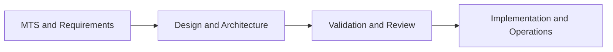

# REQUIREMENTS TRACEABILITY MATRIX

| Field | Value |
|---|---|
| Document ID | SUNDB-RTM-001 |
| Document Title | REQUIREMENTS TRACEABILITY MATRIX |
| Version | 0.1.0 |
| Status | Draft |
| Created Date | 2026-11-02 |
| Last Updated | 2026-11-02 |
| Owner | Quality Assurance |
| Related Documents | MTS, SRS, Test Plan |

## 1. Document Purpose
Matriks keterlacakan kebutuhan dari MTS ke SRS, desain, implementasi, dan pengujian.

## 2. Scope
Dokumen ini membatasi ruang lingkup, asumsi, tanggung jawab, dan output yang diharapkan untuk area Requirements Engineering. Dokumen ini diturunkan dari MTS SUNDB dan berfungsi sebagai referensi teknis yang dapat ditinjau sebelum persetujuan formal.

## 3. References
- MASTER TECHNICAL SPECIFICATION (MTS).md
- AGENT.md
- Dokumen turunannya yang relevan dalam struktur docs/
- Standar pengembangan dan operasional internal SUNDB

## 4. Definitions and Terminology
- SUNDB: Sun Universal Database.
- SUNQL: SUNDB Query Language.
- SDBF: SUNDB Binary File Format.
- WAL: Write-Ahead Log.
- MVCC: Multi-Version Concurrency Control.
- ACID: Atomicity, Consistency, Isolation, Durability.
- TBD: To be determined, pending review and decision.

## 5. Background
SUNDB dirancang sebagai database universal modular yang bersifat independen, aman, scalable, dan dapat dikembangkan secara bertahap. Dokumen ini menerjemahkan keputusan arsitektur pada MTS menjadi pedoman yang lebih aplikatif untuk tim teknis, QA, operasional, dan manajemen proyek.

## 6. Detailed Specification
### 6.1 Objectives
Tujuan utama dokumen ini adalah memberikan definisi yang terukur, terdokumentasi, dan dapat diverifikasi untuk area yang ditangani.

### 6.2 Functional Responsibilities
- Memastikan bahwa kebutuhan utama domain terdokumentasi dengan jelas.
- Mengaitkan kebutuhan tersebut dengan MTS dan area terkait.
- Menetapkan batasan, dependensi, dan risiko yang harus dikelola.

### 6.3 Constraints and Assumptions
- Implementasi utama tetap berbasis Rust.
- Semua klaim performa, keamanan, dan skalabilitas wajib disertai bukti pengujian.
- Informasi yang belum disepakati secara formal harus ditandai sebagai TBD.

## 7. Architecture or Process Flow

## 8. Interfaces and Dependencies
- Input utama: MTS, keputusan arsitektur, stakeholder requirements.
- Output utama: spesifikasi teknis, kebijakan, panduan operasional, dan kriteria verifikasi.
- Dependency: storage layer, query layer, security layer, observability, dan release management.

## 9. Security Considerations
- Akses terhadap data sensitif harus mengikuti least privilege.
- Semua credential, token, dan secret harus disimpan dengan mekanisme aman.
- Persetujuan keamanan diperlukan sebelum kebutuhan siap masuk ke tahap produksi.

## 10. Error Handling
- Kegagalan teknis harus diklasifikasikan dengan kode, akar masalah, dan tindakan pemulihan.
- Error handling harus mencakup case crash, corrupt data, permission denied, dan invalid configuration.
- Kejadian kritis harus dicatat dalam log dan dilaporkan sesuai kebijakan operasional.

## 11. Performance Considerations
- Kebutuhan penting harus dinilai melalui benchmark yang dapat diulang.
- Penggunaan memori, CPU, I/O, serta latensi harus dipantau dalam lingkungan representatif.
- Setiap hasil benchmark harus mencantumkan versi, perangkat keras, konfigurasi, dan dataset.

## 12. Testing and Verification
- Pengujian teknis harus mencakup unit, integrasi, dan validasi skenario kritikal.
- Hasil pengujian harus dipetakan ke kebutuhan dan kriteria penerimaan.
- Uji keamanan, recovery, dan kompatibilitas bersifat wajib pada proses release.

## 13. Acceptance Criteria
- Semua kebutuhan dalam dokumen ini tersurat dan dapat ditelusuri.
- Setiap keputusan yang belum final ditandai secara eksplisit sebagai TBD.
- Dokumen siap dipakai untuk review teknis, QA, dan operasi.

## 14. Open Issues
- Detail final implementasi yang belum disetujui secara formal harus ditambahkan pada dokumen open issues dan TBD.
- Setiap perubahan besar terhadap arsitektur perlu di-review dan dicatat dalam ADR atau policy perubahan.

## 15. Revision History
| Version | Date | Description | Owner |
|---|---|---|---|
| 0.1.0 | 2026-11-02 | Initial draft based on MTS and AGENT instructions | Quality Assurance |
