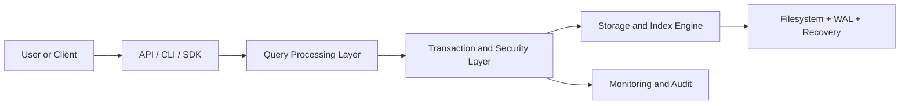

# SOFTWARE REQUIREMENTS SPECIFICATION

| Field | Value |
|---|---|
| Document ID | SUNDB-SRS-001 |
| Document Title | SOFTWARE REQUIREMENTS SPECIFICATION |
| Version | 0.1.0 |
| Status | Draft |
| Created Date | 2026-11-02 |
| Last Updated | 2026-11-02 |
| Owner | Requirements Engineering |
| Related Documents | MTS, PRD, Traceability Matrix |

## 1. Document Purpose
Spesifikasi kebutuhan perangkat lunak SUNDB mencakup kebutuhan fungsional, non-fungsional, keamanan, performa, serta kriteria penerimaan.

## 2. Scope
Dokumen ini membatasi ruang lingkup, asumsi, tanggung jawab, dan output yang diharapkan untuk area Requirements Engineering. Dokumen ini diturunkan dari MTS SUNDB dan berfungsi sebagai referensi teknis yang dapat ditinjau sebelum persetujuan formal.

## 3. References
- MASTER TECHNICAL SPECIFICATION (MTS).md
- AGENT.md
- Dokumen turunannya yang relevan dalam struktur docs/
- Standar pengembangan dan operasional internal SUNDB

## 4. Definitions and Terminology
- SUNDB: Sun Universal Database.
- SUNQL: SUNDB Query Language.
- SDBF: SUNDB Binary File Format.
- WAL: Write-Ahead Log.
- MVCC: Multi-Version Concurrency Control.
- ACID: Atomicity, Consistency, Isolation, Durability.
- TBD: To be determined, pending review and decision.

## 5. Background
SUNDB dirancang sebagai database universal modular yang bersifat independen, aman, scalable, dan dapat dikembangkan secara bertahap. Dokumen ini menerjemahkan keputusan arsitektur pada MTS menjadi pedoman yang lebih aplikatif untuk tim teknis, QA, operasional, dan manajemen proyek.

## 6. Detailed Specification
### 6.1 Tujuan Kebutuhan
Dokumen ini mendefinisikan kebutuhan utama SUNDB berdasarkan MTS, yaitu menyediakan database universal yang mampu menerima, menyimpan, mengelola, dan memproses data lintas model dalam satu platform modular. Kebutuhan ini mencakup kebutuhan fungsional, non-fungsional, dan keamanan yang dibutuhkan untuk menuju versi beta dan produksi.

### 6.2 Kebutuhan Fungsional Utama
- SUNDB-FR-001: Sistem dapat membuat, membuka, menutup, dan menghapus database secara aman.
- SUNDB-FR-002: Sistem mendukung CRUD untuk table, record, data document, dan key-value.
- SUNDB-FR-003: Sistem mendukung query SUNQL melalui parser, planner, optimizer, dan executor.
- SUNDB-FR-004: Sistem menerapkan WAL dan recovery untuk konsistensi data dan crash recovery.
- SUNDB-FR-005: Sistem mendukung index B+ Tree, hash, inverted, vector, dan graph secara terkelola.
- SUNDB-FR-006: Sistem mendukung transaksi ACID dengan MVCC dan isolation level yang terdokumentasi.
- SUNDB-FR-007: Sistem memanuhi authorization dan audit logging.
- SUNDB-FR-008: Sistem menyediakan API dan driver client untuk integrasi aplikasi.
- SUNDB-FR-009: Sistem dapat beroperasi dalam mode single-node dan cluster distributed.
- SUNDB-FR-010: Sistem menyediakan backup, restore, snapshot, dan point-in-time recovery.

### 6.3 Kebutuhan Non-Fungsional
- SUNDB-NFR-001: Performa harus dapat diukur dan dibandingkan melalui benchmark yang direproduksi.
- SUNDB-NFR-002: Sistem harus dapat menjalankan transaksi secara bersamaan dengan tingkat isolation yang stabil.
- SUNDB-NFR-003: Availability dan fault tolerance harus dibuktikan lewat pengujian recovery dan crash simulation.
- SUNDB-NFR-004: Security posture harus sesuai dengan prinsip zero trust dan least privilege.
- SUNDB-NFR-005: Maintainability dan extensibility harus dijaga melalui modular architecture dan dokumentasi per modul.
- SUNDB-NFR-006: Observability harus tersedia melalui log, metric, trace, dan alerting dasar.

### 6.4 Kebutuhan Sistem dan Pengguna
Kebutuhan pengguna utama:
- Administrator dapat mengonfigurasi database, user, dan hak akses.
- Developer dapat membangun aplikasi dengan API dan SDK.
- Operator dapat memantau performa, kesehatan, dan recovery.
- Security engineer dapat mengevaluasi akses, audit log, dan rotasi kunci.

Kebutuhan sistem:
- Mengelola lifecycle service, konfigurasi, file system, memory, dan proses recovery.
- Menyediakan antarmuka komunikasi yang aman dan konsisten.
- Menangani failure, retry, dan state recovery dengan strategi terdokumentasi.

### 6.5 Interface Requirements
- Interface CLI untuk operasi admin dan query.
- Native protocol untuk komunikasi client-server.
- REST API untuk aplikasi web dan layanan modern.
- SDK Rust, Python, dan JavaScript untuk integrasi.
- Interface monitoring untuk metrik dan status kesehatan.

### 6.6 Security Requirements
- SUNDB-SEC-001: Password tidak boleh disimpan dalam plain text.
- SUNDB-SEC-002: Semua koneksi jaringan harus menggunakan TLS 1.3 atau setara.
- SUNDB-SEC-003: Authorization harus melewati RBAC dan pemeriksaan izin per objek.
- SUNDB-SEC-004: Audit log harus mencatat operasi sensitif dan perubahan access control.
- SUNDB-SEC-005: Enkripsi at-rest menggunakan mekanisme yang terdokumentasi dan rotasi key disediakan.

### 6.7 Performance Requirements
- Rata-rata latency query dasar harus memenuhi target yang akan ditetapkan pada benchmark awal.
- Database harus mampu memproses concurrent transactions dalam beban yang direpresentasikan oleh test plan.
- Recovery dan checkpoint harus terjadi pada jangka waktu yang dapat diterima untuk operasi produksi.

### 6.8 Reliability Requirements
- Transaksi yang commit harus dapat dipulihkan.
- Data corrupt harus terdeteksi melalui checksum dan validasi page.
- Failover, recovery, dan restore harus ditest sebelum release.

### 6.9 Compatibility Requirements
- Platform target utama: Linux, Windows, dan macOS sesuai MTS.
- Format SDBF harus memiliki dokumentasi byte-level agar kompatibel dengan berbagai runtime.
- API dan driver harus memiliki mekanisme versioning untuk mencegah breakage.

### 6.10 Constraints
- Implementasi awal tetap fokus pada Rust stable dengan workspace modular.
- Fitur future dan distributed transaction cross-shard masih masuk ruang lingkup planned/tbd.
- Semua keputusan yang tidak disetujui harus ditandai sebagai TBD dan di-review.

## 7. Architecture or Process Flow

## 8. Interfaces and Dependencies
- Input: MTS, product requirements, stakeholder alignment, engineering standards.
- Output: SRS, traceability matrix, test plan, implementation backlog.
- Dependency: core engine, transaction engine, storage engine, security controls, observability, and release pipeline.

## 9. Security Considerations
- Semua kebutuhan akses dan perubahan data harus mengikuti model RBAC yang terdokumentasi.
- Data sensitif tidak boleh dipindahkan ke proses AI atau layanan eksternal tanpa izin eksplisit.
- Audit log harus dijaga integritasnya untuk investigasi dan forensic readiness.

## 10. Error Handling
- Sistem wajib mendefinisikan kode error stabil untuk invalid query, permission denied, storage error, transaction aborted, dan recovery failure.
- Error harus disertai pesan aman, kategori, dan langkah mitigasi yang dapat diikuti oleh operator atau pengembang.

## 11. Performance Considerations
- Permintaan query, transaksi, dan recovery harus diukur dalam workload yang mewakili aplikasi nyata.
- Sistem harus memonitor hit ratio buffer pool, latency, throughput, dan penggunaan disk.
- Benchmark harus dikelola oleh QA dan Performance Engineering.

## 12. Testing and Verification
- Unit test harus membuktikan fungsi CRUD, query parsing, index access, dan security checks.
- Integration test harus validasi pipeline lengkap dari request ke storage dan recovery.
- Acceptance testing harus mencakup data integrity, fault tolerance, security, dan distributed behavior sesuai status fitur.

## 13. Acceptance Criteria
- Kebutuhan fungsional dan non-fungsional dipetakan ke spesifikasi yang jelas.
- Semua fitur yang diklaim dalam release harus memiliki test coverage dan verification status.
- Semua item TBD dipetakan pada keputusan yang memerlukan persetujuan manusia.

## 14. Open Issues
- Final target prioritas implementasi antara multi-model engine dan distributed platform.
- Detail perangkat benchmark dan workload standard belum final.
- Penetapan kebijakan audit retention dan key rotation masih memerlukan persetujuan.

## 15. Revision History
| Version | Date | Description | Owner |
|---|---|---|---|
| 0.1.0 | 2026-11-02 | Initial requirements specification derived from MTS and AGENT instructions | Requirements Engineering |
