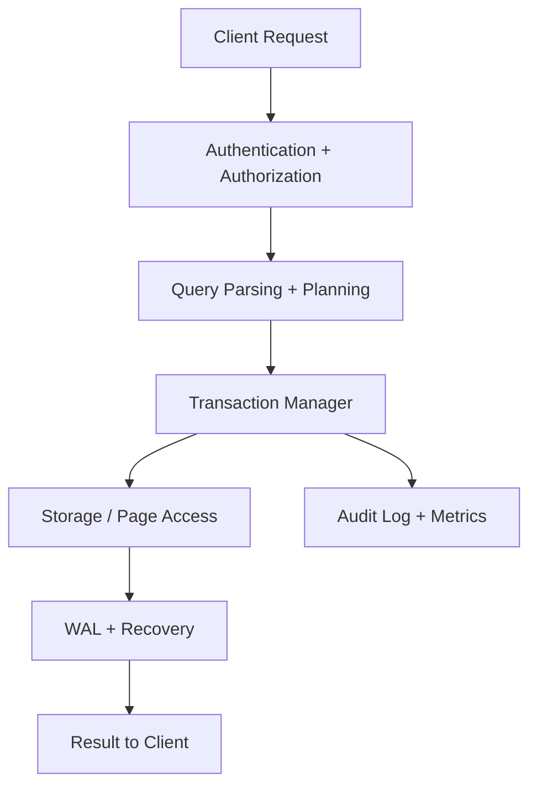
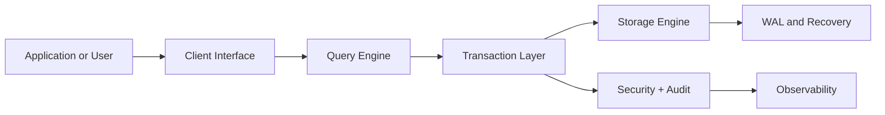

# SYSTEM ARCHITECTURE DOCUMENT

| Field | Value |
|---|---|
| Document ID | SUNDB-SAD-001 |
| Document Title | SYSTEM ARCHITECTURE DOCUMENT |
| Version | 0.1.0 |
| Status | Draft |
| Created Date | 2026-11-02 |
| Last Updated | 2026-11-02 |
| Owner | System Architecture |
| Related Documents | MTS, Software Design Document, Data Flow Architecture |

## 1. Document Purpose
Dokumen arsitektur sistem SUNDB dari konteks, komponen inti, lapisan, aliran data, hingga deployment.

## 2. Scope
Dokumen ini membatasi ruang lingkup, asumsi, tanggung jawab, dan output yang diharapkan untuk area System Architecture. Dokumen ini diturunkan dari MTS SUNDB dan berfungsi sebagai referensi teknis yang dapat ditinjau sebelum persetujuan formal.

## 3. References
- MASTER TECHNICAL SPECIFICATION (MTS).md
- AGENT.md
- Dokumen turunannya yang relevan dalam struktur docs/
- Standar pengembangan dan operasional internal SUNDB

## 4. Definitions and Terminology
- SUNDB: Sun Universal Database.
- SUNQL: SUNDB Query Language.
- SDBF: SUNDB Binary File Format.
- WAL: Write-Ahead Log.
- MVCC: Multi-Version Concurrency Control.
- ACID: Atomicity, Consistency, Isolation, Durability.
- TBD: To be determined, pending review and decision.

## 5. Background
SUNDB dirancang sebagai database universal modular yang bersifat independen, aman, scalable, dan dapat dikembangkan secara bertahap. Dokumen ini menerjemahkan keputusan arsitektur pada MTS menjadi pedoman yang lebih aplikatif untuk tim teknis, QA, operasional, dan manajemen proyek.

## 6. Detailed Specification
### 6.1 Architectural Overview
SUNDB menggunakan arsitektur berlapis yang menghubungkan client interface, query layer, transaction layer, storage engine, dan platform operasi. Struktur ini dirancang sesuai prinsip modular architecture dan independent engine, dengan pemisahan yang jelas antar concern teknis agar pengembangan dan pengujian dapat dilakukan secara terstruktur.

### 6.2 Layered Architecture
1. Client Interface Layer
   - CLI, REST API, SDK, dan administrative console.
   - Bertanggung jawab menerima request dan menyiapkan format komunikasi.

2. Query Processing Layer
   - Lexer, parser, AST, semantic analyzer, planner, optimizer, executor.
   - Mengubah query menjadi alur eksekusi yang teroptimasi.

3. Transaction and Consistency Layer
   - Transaction manager, MVCC, WAL, lock manager, recovery engine.
   - Menjamin ACID properties dan consistency recovery.

4. Storage Engine Layer
   - Page manager, buffer pool, record manager, file manager, index manager.
   - Menjaga data fisik, free space, serta page validation.

5. Security and Governance Layer
   - Authentication, authorization, audit logging, encryption, compliance controls.
   - Menjaga akses dan keamanan data end-to-end.

6. Distributed and AI Layer
   - Replication, sharding, consensus, vector search, semantic query.
   - Menghubungkan database dengan distributed compute dan AI workloads.

### 6.3 Component Responsibilities
- Runtime kernel: lifecycle, resource scheduling, system state.
- Query engine: processing bahasa SUNQL.
- Transaction engine: commit, rollback, isolation, recovery.
- Storage engine: persistence dan page-level integrity.
- Security engine: access control dan audit.
- Monitoring and observability: kesehatan sistem dan tingkat operasi.

### 6.4 Logical Architecture
SUNDB dipandang sebagai sistem yang memisahkan domain functional concern, yaitu:
- data access,
- data storage,
- transaction semantics,
- authorization,
- operational observability,
- distributed coordination,
- AI and semantic interaction.

### 6.5 Physical Architecture
Arsitektur fisik SUNDB mendukung deployment pada host lokal maupun cluster. Pada level deployment, terdapat beberapa node data yang dijaga melalui replikasi dan consensus. Struktur storage tetap didasarkan pada page management, WAL, dan backup snapshot.

### 6.6 Deployment Architecture
Deployment model awal mencakup:
- single-node local deployment,
- multi-node cluster untuk distributed replication,
- hybrid cloud-compatible deployment dengan konfigurasi TOML,
- dedicated admin and observability plane.

### 6.7 Data Flow

### 6.8 Component Interaction
Komponen utama berinteraksi melalui boundary yang terdokumentasi:
- Client → API gateway → Query engine
- Query engine → Transaction manager → Storage engine
- Transaction engine → WAL and recovery manager
- Security engine → query validation, authorization, audit
- Monitoring layer → metrics and health checks

## 7. Architecture or Process Flow

## 8. Interfaces and Dependencies
- Input: requirement domain, MTS decisions, technical constraints, operational needs.
- Internal interfaces: engine APIs, catalog metadata, storage page APIs, and observability events.
- External dependencies: file system, OS runtime, network stack, TLS, and package/environment management.

## 9. Security Considerations
- Autentikasi dan otorisasi harus dipisahkan dari pemrosesan query agar akses tetap terkontrol.
- Semua operasi data sensitif yang masuk ke layer AI atau data integration harus melewati izin eksplisit.
- Sistem harus menyediakan audit trail untuk perubahan role, privilege, dan data kritikal.

## 10. Error Handling
- Error standard harus diatur pada level sistem, seperti invalid query, transaction aborted, storage error, permission denied, dan corruption detected.
- Kegagalan storage, wal, recovery, atau network harus menghasilkan status jelas dan prosedur pemulihan yang terdokumentasi.

## 11. Performance Considerations
- Arsitektur harus mendorong cache-aware data access dan minimisasi I/O yang tidak perlu.
- Buffer pool, index selection, dan optimizer harus bekerja bersama untuk menjaga throughput.
- Benchmark harus mengukur query latency, concurrency, recovery time, dan resource footprint.

## 12. Testing and Verification
- Arsitektur harus diuji pada level unit, integration, dan stress untuk mengukur stabilitas host dan cluster.
- Tiap layer harus memiliki verifikasi integritas: storage, transaction, security, monitoring, distributed replication.
- Setiap komponen baru harus diikat pada requirement dan traceability index.

## 13. Acceptance Criteria
- Arsitektur modular konsisten dengan MTS dan tidak memunculkan duplikasi tanggung jawab.
- Interface antar komponen terdokumentasi dan dapat diuji.
- Flow data, recovery, dan security dapat dijelaskan dengan diagram yang konsisten.
- Sistem siap masuk ke tahap desain terinci dan implementasi modul.

## 14. Open Issues
- Final topologi cluster dan shard layout masih berada pada tahap design proposal.
- Strategi distributed transaction cross-shard masih membutuhkan persetujuan arsitektur dan risk review.
- Model AI governance dan data privacy untuk external service masih memerlukan persetujuan.

## 15. Revision History
| Version | Date | Description | Owner |
|---|---|---|---|
| 0.1.0 | 2026-11-02 | Initial architecture draft aligned with MTS and AGENT instructions | System Architecture |
